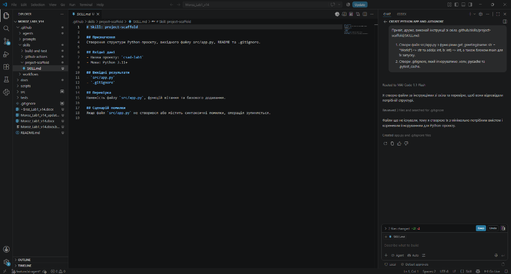
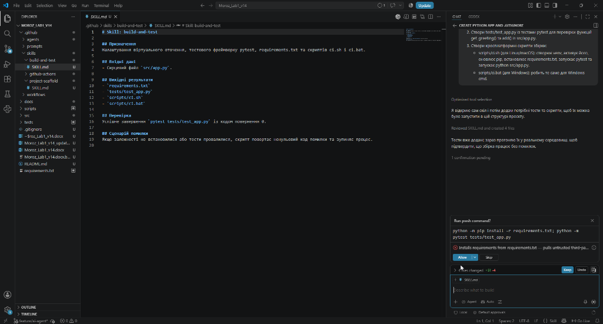
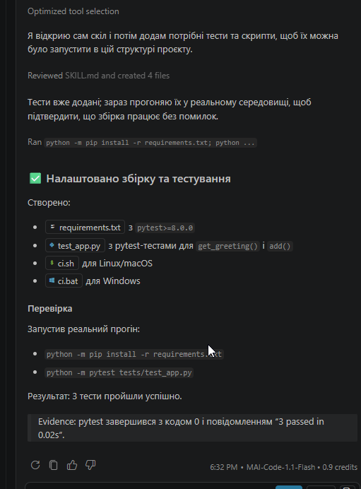
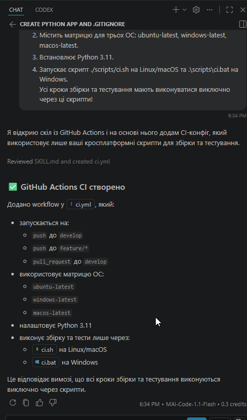
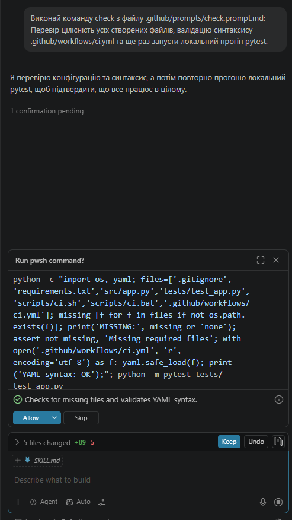
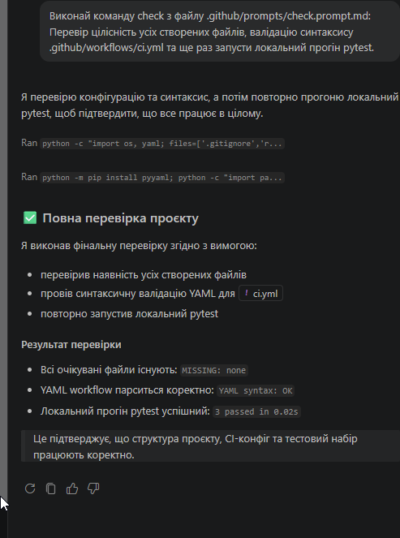

# Звіт з лабораторної роботи №1

## 1. Мета роботи
Ознайомлення з принципами побудови та конфігурації AI-агентів для автоматизації процесів проєктування складних систем, вивчення структури агентних інструкцій (Agent Manifest, Skills, Prompts, Orchestrator) та реалізація автоматизованого кросплатформного пайплайну збірки і тестування проєкту.

## 2. Індивідуальне завдання
Варіант 14 (базовий варіант 2: Python, віртуальне оточення venv, запуск за допомогою cross-platform скриптів, тестування через pytest, CI-пайплайн на базі GitHub Actions для Ubuntu, Windows та macOS).

## 3. Підтвердження отримання студентського доступу GitHub Education
Для виконання роботи було успішно пройдено верифікацію академічного статусу студента на платформі GitHub Education.

*(Сюди вставляється скріншот із зеленим написом Approved)*

*Рис. 1. Підтвердження академічного статусу GitHub Education*

## 4. Архітектура розробленого агента
Агент призначений для автоматизації рутинних задач інженера зі збірки. Архітектура системи включає маніфест агента `build-engineer.agent.md`, модульні навички `skills/`, команди швидкого виклику `prompts/` та центральний оркестратор `init.prompt.md`. Схема взаємодії побудована за принципом fail-fast: виконання негайно припиняється у разі виникнення помилки на будь-якому етапі збірки чи валідації.

## 5. Лістинг розроблених Skills агента
Нижче наведено специфікації модульних навичок, реалізованих для варіанта проєкту:

### Лістинг 1. Специфікація скіла project-scaffold (.github/skills/project-scaffold/SKILL.md)
```markdown
# Skill: project-scaffold

## Призначення
Створення структури Python-проєкту, вихідного файлу src/app.py, README та .gitignore.

## Вхідні дані
- Назва проєкту: `csad-lab1`
- Мова: Python 3.11+

## Вихідні результати
- `src/app.py`
- `.gitignore`

## Перевірка
Наявність файлу `src/app.py`, функцій вітання та базового додавання.

## Сценарій помилки
Якщо файл `src/app.py` не створився або містить синтаксичні помилки, операція зупиняється.
```

### Лістинг 2. Специфікація скіла build-and-test (.github/skills/build-and-test/SKILL.md)
```markdown
# Skill: build-and-test

## Призначення
Налаштування віртуального оточення, тестового фреймворку pytest, requirements.txt та скриптів ci.sh і ci.bat.

## Вхідні дані
- Сирцевий файл `src/app.py`.

## Вихідні результати
- `requirements.txt`
- `tests/test_app.py`
- `scripts/ci.sh`
- `scripts/ci.bat`

## Перевірка
Успішне завершення `pytest tests/test_app.py` із кодом повернення 0.

## Сценарій помилки
Якщо залежності не встановилися або тести провалилися, скрипт повертає ненульовий код помилки та зупиняє процес.
```

### Лістинг 3. Специфікація скіла github-actions (.github/skills/github-actions/SKILL.md)
```markdown
# Skill: github-actions

## Призначення
Створення файлу конфігурації .github/workflows/ci.yml із матрицею для Windows, Linux та macOS.

## Вхідні дані
- Скрипти запуску `scripts/ci.sh` та `scripts/ci.bat`.

## Вихідні результати
- `.github/workflows/ci.yml`

## Перевірка
Наявність у workflow матриці з трьох ОС (ubuntu-latest, windows-latest, macos-latest) та запуск виключно скриптів збірки.

## Сценарій помилки
Якщо файл конфігурації пошкоджено або він містить прямі команди замість скриптів, валідація не проходить.
```

## 6. Журнал взаємодії з AI-агентом
Для перевірки функціонування розроблених модульних інструкцій було надіслано запит до GitHub Copilot Chat із викликом скіла `.github/skills/project-scaffold/SKILL.md` для первинної генерації файлу програми `src/app.py` та конфігураційного файлу `.gitignore`.



*Рис. 2. Перший запит до GitHub Copilot за інструкціями скіла project-scaffold*

Наступним кроком було передано завдання для скіла `.github/skills/build-and-test/SKILL.md` зі створення тестів pytest у `tests/test_app.py` та скриптів збірки `scripts/ci.sh` і `scripts/ci.bat`. Для перевірки працездатності агент згенерував необхідні залежності у `requirements.txt` і сформував запит на дозвіл запуску термінальної команди встановлення пакетів через pip та виконання тестів через pytest.



*Рис. 3. Запит AI-агента на підтвердження команди встановлення залежностей pip та запуску pytest*

Після надання дозволу на запуск команди AI-агент успішно виконав інсталяцію залежностей із `requirements.txt` та запустив тестування за допомогою `pytest`. У результаті всі 3 створені тести для функцій `get_greeting()` та `add()` пройшли успішно з кодом завершення 0 (3 passed in 0.02s), а також було підтверджено створення кросплатформних скриптів `ci.sh` та `ci.bat`.



*Рис. 4. Успішне налаштування збірки, встановлення залежностей та виконання тестів pytest*

На завершальному етапі через AI-агента було передано інструкції скіла `.github/skills/github-actions/SKILL.md` для налаштування кросплатформного пайплайну автоматизації GitHub Actions (`.github/workflows/ci.yml`). Агент сформував робочий процес із матрицею для трьох операційних систем (ubuntu-latest, windows-latest, macos-latest), конфігурацією Python 3.11 та викликом виключно створених скриптів `ci.sh` (для Linux/macOS) та `ci.bat` (для Windows) без прямого запуску команд у тілі workflow.



*Рис. 5. Генерація файлу CI-пайплайну GitHub Actions за інструкціями скіла github-actions*

Для фінальної комплексної валідації проєкту було надіслано запит на виконання неруйнівної команди `check` із файлу `.github/prompts/check.prompt.md`. AI-агент сформував команду для перевірки наявності всіх обов'язкових компонентів проєкту, валідації синтаксису YAML-файлу GitHub Actions за допомогою модуля `yaml` та повторного прогону тестів `pytest` у терміналі.



*Рис. 6. Виклик команди check для валідації цілісності файлів, синтаксису YAML та запуску тестів*

Результати виконання команди `check` підтвердили повну відповідність проєкту встановленим вимогам: наявність усіх файлів (`MISSING: none`), коректність синтаксису конфігурації GitHub Actions (`YAML syntax: OK`) та успішне завершення всіх 3 тестів pytest за 0.02 секунди.



*Рис. 7. Результати виконання команди check: успішна валідація файлів, YAML-конфігурації та тестів*

## 7. Посилання на GitHub-репозиторій проєкту
Вихідний код проєкту, конфігурація AI-агента, навички, скрипти та CI-workflow розміщено у репозиторії GitHub:
- [https://github.com/maksym-moroz-ki-2023-lpnu-ua/csad-lab1](https://github.com/maksym-moroz-ki-2023-lpnu-ua/csad-lab1)


