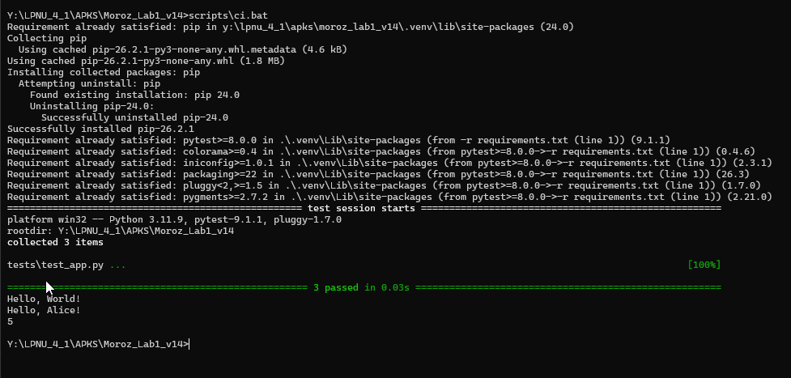
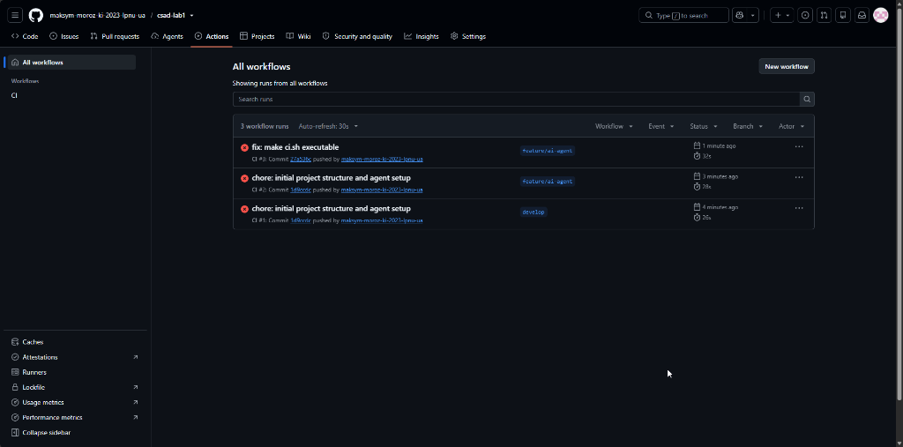
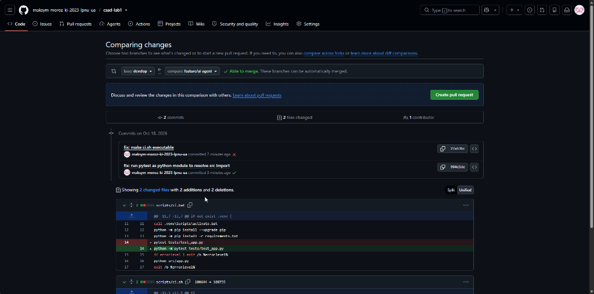
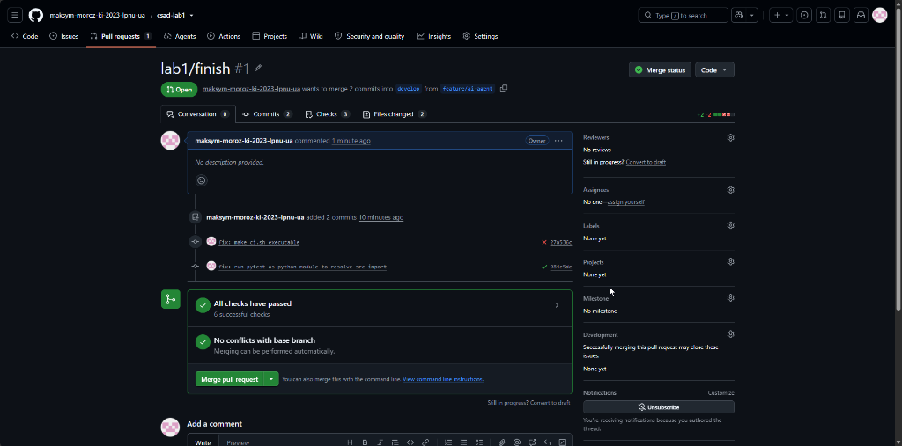
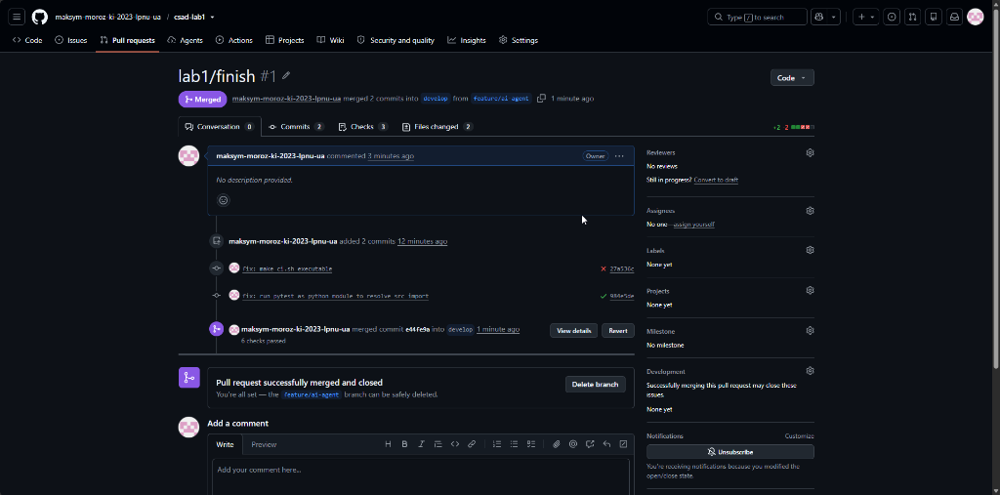
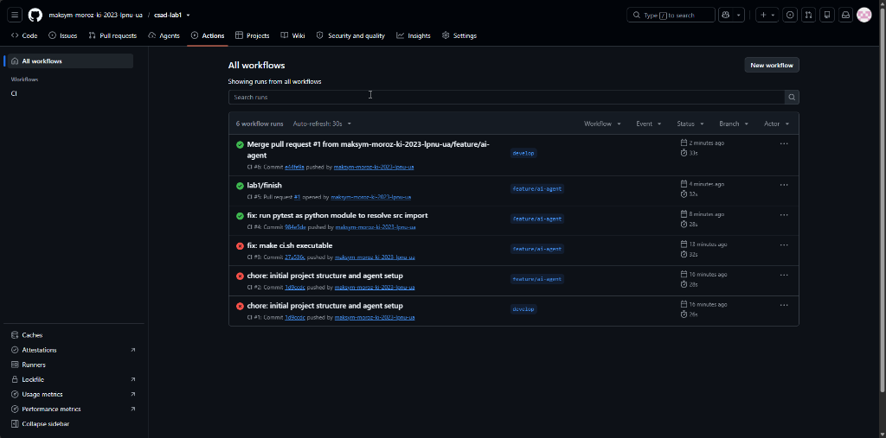

# Звіт з лабораторної роботи №1: CSAD

## 1. Мета роботи
Набути практичних навичок проєктування та використання AI-автоматизації у розробці програмного забезпечення: створення спеціалізованого AI-агента з навичками (skills), командами (commands) та оркестрацією для автоматизованої генерації, складання, тестування і перевірки кросплатформного проєкту «Hello World» із конфігурацією CI/CD на базі GitHub Actions.

## 2. Теоретичні відомості та опис задачі AI-агента
**AI-агент** — це спеціалізований програмний помічник, який має чітко визначену роль, набір формальних правил поведінки, доступні інструменти (інтерфейси взаємодії з оточенням) та очікуваний кінцевий результат. На відміну від одноразового запиту до великої мовної моделі (LLM), агент функціонує за узгодженим детермінованим процесом і здатний виконувати послідовність взаємопов’язаних операцій із контролем проміжних результатів.

**Опис задачі, яку вирішує AI-агент:** У сучасній розробці програмного забезпечення процес ручного створення структури нового проєкту, конфігурації віртуального оточення, написання скриптів складання та налаштування CI-пайплайнів для декількох цільових платформ (Windows, Linux, macOS) супроводжується значною кількістю людських помилок (некоректні права файлів, розбіжності шляхів до інтерпретатора, конфлікти залежностей). Розроблений AI-агент автоматизує роль Build Engineer, забезпечуючи стандартизоване генерування структури, детерміновану ізоляцію середовища venv, виконання pytest та безпомилкове формування кросплатформного GitHub Actions workflow без ручного втручання.

Ключовими архітектурними компонентами системи AI-агента є:
1. **Agent Manifest (Маніфест агента)** — центральний документ, що детально описує агента: його назву, призначення, роль, область відповідальності, обмеження безпеки (заборонені дії), алгоритм роботи, доступні навички та формальні критерії успішного завершення завдання. Маніфест базується на принципі Fail-Fast, що виключає неявні припущення та зупиняє виконання при виникненні будь-якої помилки.
2. **Skill (Навичка)** — модульна, повторно використовувана інструкція для вирішення окремого класу задач. Коректно спроєктований скіл визначає умови свого застосування, вхідні дані, вихідні артефакти, критерії перевірки успішності та чіткі сценарії обробки нештатних ситуацій.
3. **Command (Промпт-команда)** — іменована атомарна операція швидкого виклику, яку користувач або зовнішній процес може ініціювати явно (наприклад, `git-init`, `create-project`, `check`). Команда є лаконічною, однозначною та придатною до багаторазового відтворення.
4. **Orchestrator (Оркестратор)** — керівний модуль, що координує спільну роботу навичок та команд. Він здійснює валідацію передумов, послідовно запускає операції у визначеному порядку, передає контекст між кроками, контролює коди завершення процесів та негайно перериває ланцюжок виконання у разі виникнення помилок.

## 3. Індивідуальне завдання
**Варіант 14 (базовий варіант 2):**
- **Мова програмування:** Python 3.11+;
- **Система ізоляції та запуску:** віртуальне оточення venv, кросплатформні скрипти запуску `scripts/ci.sh` (Linux/macOS) та `scripts/ci.bat` (Windows);
- **Модульне тестування:** фреймворк pytest;
- **Автоматизація CI/CD:** workflow GitHub Actions із матрицею з трьох операційних систем (`ubuntu-latest`, `windows-latest`, `macos-latest`), у якому всі дії збірки та тестування викликаються виключно через скрипти `ci.sh` та `ci.bat`.

## 4. Хід виконання роботи

### 4.1. Підтвердження академічного статусу GitHub Education
Для виконання роботи було успішно пройдено верифікацію академічного статусу студента на платформі GitHub Education, що надало доступ до інструментів GitHub Copilot та GitHub Actions.

*(Сюди вставляється скріншот із зеленим написом Approved)*

*Рис. 1. Підтвердження академічного статусу GitHub Education*

### 4.2. Таблиця взаємодії Manifest, Skills, Commands та Orchestrator
Архітектурну взаємодію між складовими частинами розробленої системи AI-агента зведено у таблиці 1:

**Таблиця 1. Взаємодія компонентів системи AI-агента**

| Тип компонента | Назва / Файл | Призначення | Вхідні дані | Вихідні дані та зв’язки |
| :--- | :--- | :--- | :--- | :--- |
| **Agent Manifest** | `.github/agents/build-engineer.agent.md` | Визначає роль Build Engineer, правила безпеки та критерії успіху | Вимоги до Python-проєкту | Керує дозволеними діями агента, запускає skills |
| **Orchestrator** | `.github/prompts/init.prompt.md` | Центральна координація послідовного запуску всіх етапів | Користувацька команда init | Викликає послідовно commands, реалізує fail-fast |
| **Command** | `.github/prompts/git-init.prompt.md` | Ініціалізація Git та валідація .gitignore | Команда git-init | Репозиторій git, гілки develop/feature |
| **Skill / Command** | `project-scaffold` / `create-project` | Створення структури проєкту та коду застосунку | Назва проєкту, Python 3.11+ | `src/app.py`, `.gitignore` |
| **Skill / Command** | `build-and-test` / `create-build` | Налаштування оточення, запуск тестів та скриптів | `src/app.py` | `requirements.txt`, `test_app.py`, `ci.sh`, `ci.bat` |
| **Skill / Command** | `github-actions` / `create-actions` | Створення кросплатформного CI workflow | `scripts/ci.sh`, `scripts/ci.bat` | `.github/workflows/ci.yml` (матриця 3 ОС) |
| **Command** | `.github/prompts/check.prompt.md` | Неруйнівна комплексна перевірка проєкту та тестів | Команда check | Звіт перевірки, валідація YAML, pytest code 0 |

### 4.3. Лістинг manifest агента (.github/agents/build-engineer.agent.md)
#### Лістинг 1. Специфікація маніфесту агента build-engineer
```markdown
# Agent: Build Engineer

## Роль
Спеціалізований інженер з автоматизації збірки та CI/CD для проєктів на мові Python.

## Область відповідальності
- Створення початкової структури проєкту та вихідного коду.
- Налаштування системного середовища venv та запуск тестів pytest.
- Написання кросплатформних скриптів збірки та конфігурація GitHub Actions.

## Заборонені дії
- Видалення файлів без підтвердження.
- Примусове переписування історії Git (force push, reset --hard).
- Додавання секретів, токенів та паролів у репозиторій.
- Прямий виклик збірки в YAML-файлі замість заклику скриптів.

## Критерії успішного завершення
Усі тести проходять успішно на Windows, Linux та macOS через скрипти ci.bat та ci.sh.
```

### 4.4. Лістинги специфікацій Skills агента
#### Лістинг 2. Специфікація скіла project-scaffold (.github/skills/project-scaffold/SKILL.md)
```markdown
# Skill: project-scaffold

## Призначення
Створення структури Python-проєкту, вихідного файлу src/app.py, README та .gitignore.

## Вхідні дані
- Назва проєкту: `csad-lab1`
- Мова: Python 3.11+

## Вихідні результати
- `src/app.py`
- `.gitignore`

## Перевірка
Наявність файлу `src/app.py`, функцій вітання та базового додавання.

## Сценарій помилки
Якщо файл `src/app.py` не створився або містить синтаксичні помилки, операція зупиняється.
```

#### Лістинг 3. Специфікація скіла build-and-test (.github/skills/build-and-test/SKILL.md)
```markdown
# Skill: build-and-test

## Призначення
Налаштування віртуального оточення, тестового фреймворку pytest, requirements.txt та скриптів ci.sh і ci.bat.

## Вхідні дані
- Сирцевий файл `src/app.py`.

## Вихідні результати
- `requirements.txt`
- `tests/test_app.py`
- `scripts/ci.sh`
- `scripts/ci.bat`

## Перевірка
Успішне завершення `pytest tests/test_app.py` із кодом повернення 0.

## Сценарій помилки
Якщо залежності не встановилися або тести провалилися, скрипт повертає ненульовий код помилки та зупиняє процес.
```

#### Лістинг 4. Специфікація скіла github-actions (.github/skills/github-actions/SKILL.md)
```markdown
# Skill: github-actions

## Призначення
Створення файлу конфігурації .github/workflows/ci.yml із матрицею для Windows, Linux та macOS.

## Вхідні дані
- Скрипти запуску `scripts/ci.sh` та `scripts/ci.bat`.

## Вихідні результати
- `.github/workflows/ci.yml`

## Перевірка
Наявність у workflow матриці з трьох ОС (ubuntu-latest, windows-latest, macos-latest) та запуск виключно скриптів збірки.

## Сценарій помилки
Якщо файл конфігурації пошкоджено або він містить прямі команди замість скриптів, валідація не проходить.
```

### 4.5. Лістинги команд швидкого виклику (Prompts) та оркестратора
#### Лістинг 5. Команда-оркестратор init (.github/prompts/init.prompt.md)
```markdown
# Command: init (Orchestrator)

Виконай послідовну ініціалізацію проєкту за принципом fail-fast:
1. Запусти команду `git-init` для налаштування Git та .gitignore.
2. Запусти команду `create-project` для створення структури та коду `src/app.py`.
3. Запусти команду `create-build` для налаштування venv, requirements.txt, pytest та скриптів ci.sh / ci.bat.
4. Запусти команду `create-actions` для генерації .github/workflows/ci.yml.
5. Запусти команду `check` для неруйнівної перевірки всієї структури, валідації синтаксису YAML та запуску тестів pytest.

Якщо будь-який крок завершується з ненульовим кодом помилки, негайно зупини процес (fail-fast).
```

#### Лістинг 6. Команда валідації check (.github/prompts/check.prompt.md)
```markdown
# Command: check

Виконай неруйнівну валідацію проєкту:
1. Перевір наявність обов'язкових файлів: .gitignore, requirements.txt, src/app.py, tests/test_app.py, scripts/ci.sh, scripts/ci.bat, .github/workflows/ci.yml.
2. Перевір синтаксичну коректність YAML-файлу workflow через python yaml.safe_load.
3. Виконай локальний запуск тестів через python -m pytest tests/test_app.py.
```

#### Лістинг 7. Команда git-init (.github/prompts/git-init.prompt.md)
```markdown
# Command: git-init

Ініціалізуй Git-репозиторій та налаштуй ігнорування артефактів:
1. Перевір наявність репозиторію git.
2. Переконайся, що створено гілки `develop` та `feature/ai-agent`.
3. Налаштуй .gitignore для виключення .venv/, __pycache__/, .pytest_cache/, тимчасових файлів та секретів.
```

#### Лістинг 8. Команди виклику скілів: create-project, create-build, create-actions
```markdown
--- create-project.prompt.md ---
# Command: create-project
Виконай інструкції зі скіла `.github/skills/project-scaffold/SKILL.md`:
1. Створи вихідний файл `src/app.py` з функціями `get_greeting()` та `add()`.
2. Переконайся у наявності блоку main для автономного запуску.

--- create-build.prompt.md ---
# Command: create-build
Виконай інструкції зі скіла `.github/skills/build-and-test/SKILL.md`:
1. Створи `requirements.txt` із залежністю `pytest>=8.0.0`.
2. Створи `tests/test_app.py` із тестами pytest.
3. Створи кросплатформні скрипти запуску `scripts/ci.sh` (Linux/macOS) та `scripts/ci.bat` (Windows).

--- create-actions.prompt.md ---
# Command: create-actions
Виконай інструкції зі скіла `.github/skills/github-actions/SKILL.md`:
1. Створи `.github/workflows/ci.yml`.
2. Налаштуй матрицю ОС: ubuntu-latest, windows-latest, macos-latest.
3. Забезпеч виклик складання та тестів виключно через скрипти `ci.sh` та `ci.bat`.
```

### 4.6. Структура проєкту та лістинги вихідного коду, скриптів і CI workflow
Файлова структура розробленого репозиторію:
```text
Moroz_Lab1_v14/
│
├── .github/
│   ├── agents/
│   │   └── build-engineer.agent.md
│   ├── prompts/
│   │   ├── check.prompt.md
│   │   ├── create-actions.prompt.md
│   │   ├── create-build.prompt.md
│   │   ├── create-project.prompt.md
│   │   ├── git-init.prompt.md
│   │   └── init.prompt.md
│   ├── skills/
│   │   ├── build-and-test/SKILL.md
│   │   ├── github-actions/SKILL.md
│   │   └── project-scaffold/SKILL.md
│   └── workflows/
│       └── ci.yml
├── docs/
│   ├── architecture.md
│   └── report.md
├── scripts/
│   ├── ci.bat
│   └── ci.sh
├── src/
│   └── app.py
├── tests/
│   └── test_app.py
├── .gitignore
├── README.md
└── requirements.txt
```

#### Лістинг 9. Вихідний файл програми src/app.py
```python
def get_greeting(name: str = "World") -> str:
    return f"Hello, {name}!"


def add(a: int, b: int) -> int:
    return a + b


def main() -> None:
    print(get_greeting())
    print(get_greeting("Alice"))
    print(add(2, 3))


if __name__ == "__main__":
    main()
```

#### Лістинг 10. Файл залежностей requirements.txt
```text
pytest>=8.0.0
```

#### Лістинг 11. Модульні тести tests/test_app.py
```python
from src.app import add, get_greeting


def test_get_greeting_default() -> None:
    assert get_greeting() == "Hello, World!"


def test_get_greeting_custom_name() -> None:
    assert get_greeting("Alice") == "Hello, Alice!"


def test_add() -> None:
    assert add(2, 3) == 5
    assert add(-1, 1) == 0
```

#### Лістинг 12. Кросплатформний скрипт збірки scripts/ci.bat (Windows)
```bat
@echo off
setlocal

set "ROOT_DIR=%~dp0.."
cd /d "%ROOT_DIR%"

if not exist .venv (
    python -m venv .venv
)

call .venv\Scripts\activate.bat
python -m pip install --upgrade pip
python -m pip install -r requirements.txt
python -m pytest tests/test_app.py
if errorlevel 1 exit /b %errorlevel%
python src/app.py
exit /b %errorlevel%
```

#### Лістинг 13. Кросплатформний скрипт збірки scripts/ci.sh (Linux/macOS)
```bash
#!/usr/bin/env bash
set -euo pipefail

ROOT_DIR="$(cd "$(dirname "${BASH_SOURCE[0]}")/.." && pwd)"
cd "$ROOT_DIR"

if [ ! -d .venv ]; then
    python3 -m venv .venv
fi

source .venv/bin/activate
python -m pip install --upgrade pip
python -m pip install -r requirements.txt
python -m pytest tests/test_app.py
python src/app.py
```

#### Лістинг 14. CI-пайплайн GitHub Actions (.github/workflows/ci.yml)
```yaml
name: CI

on:
  push:
    branches:
      - develop
      - 'feature/*'
  pull_request:
    branches:
      - develop

jobs:
  build-and-test:
    runs-on: ${{ matrix.os }}
    strategy:
      fail-fast: false
      matrix:
        os: [ubuntu-latest, windows-latest, macos-latest]

    steps:
      - name: Checkout repository
        uses: actions/checkout@v4

      - name: Set up Python 3.11
        uses: actions/setup-python@v5
        with:
          python-version: '3.11'

      - name: Run CI script on Linux/macOS
        if: runner.os != 'Windows'
        shell: bash
        run: ./scripts/ci.sh

      - name: Run CI script on Windows
        if: runner.os == 'Windows'
        shell: cmd
        run: .\scripts\ci.bat
```

### 4.7. Журнал взаємодії з AI-агентом (GitHub Copilot)
Для перевірки функціонування розроблених модульних інструкцій було надіслано перший запит до GitHub Copilot Chat із викликом скіла `.github/skills/project-scaffold/SKILL.md` для первинної генерації файлу програми `src/app.py` та конфігураційного файлу `.gitignore`.


*Рис. 2. Перший запит до GitHub Copilot за інструкціями скіла project-scaffold*

Наступним кроком було передано завдання для скіла `.github/skills/build-and-test/SKILL.md` зі створення тестів pytest у `tests/test_app.py` та скриптів збірки `scripts/ci.sh` і `scripts/ci.bat`. Для перевірки працездатності агент згенерував необхідні залежності у `requirements.txt` і сформував запит на дозвіл запуску термінальної команди встановлення пакетів через pip та виконання тестів через pytest.


*Рис. 3. Запит AI-агента на підтвердження команди встановлення залежностей pip та запуску pytest*

Після надання дозволу на запуск команди AI-агент успішно виконав інсталяцію залежностей із `requirements.txt` та запустив тестування за допомогою `pytest`. У результаті всі 3 створені тести для функцій `get_greeting()` та `add()` пройшли успішно з кодом завершення 0 (3 passed in 0.02s), а також було підтверджено коректне створення кросплатформних скриптів `ci.sh` та `ci.bat`.


*Рис. 4. Успішне налаштування збірки, встановлення залежностей та виконання тестів pytest*

На наступному етапі через AI-агента було передано інструкції скіла `.github/skills/github-actions/SKILL.md` для налаштування кросплатформного пайплайну автоматизації GitHub Actions (`.github/workflows/ci.yml`). Агент сформував робочий процес із матрицею для трьох операційних систем (`ubuntu-latest`, `windows-latest`, `macos-latest`), конфігурацією Python 3.11 та викликом виключно скриптів `ci.sh` та `ci.bat`.


*Рис. 5. Генерація файлу CI-пайплайну GitHub Actions за інструкціями скіла github-actions*

Для фінальної комплексної валідації проєкту було надіслано запит на виконання неруйнівної команди `check` із файлу `.github/prompts/check.prompt.md`. AI-агент сформував команду для перевірки наявності всіх обов'язкових компонентів проєкту, валідації синтаксису YAML-файлу GitHub Actions за допомогою модуля `yaml` та повторного прогону тестів `pytest` у терміналі.


*Рис. 6. Виклик команди check для валідації цілісності файлів, синтаксису YAML та запуску тестів*

Результати виконання команди `check` підтвердили повну відповідність проєкту встановленим вимогам: наявність усіх файлів (`MISSING: none`), коректність синтаксису конфігурації GitHub Actions (`YAML syntax: OK`) та успішне завершення всіх 3 тестів pytest за 0.02 секунди.


*Рис. 7. Результати виконання команди check: успішна валідація файлів, YAML-конфігурації та тестів*

### 4.8. Результати локального складання і тестування проєкту
Для перевірки коректності роботи створених скриптів безпосередньо у локальному середовищі було здійснено запуск скрипта `scripts\ci.bat` у терміналі Windows.

Скрипт успішно активував віртуальне оточення `.venv`, оновив менеджер пакетів `pip`, перевірив наявність залежностей із `requirements.txt`, виконав запуск усіх 3 тестів pytest (3 passed in 0.03s), а також виконав головний модуль `src/app.py`, що вивів очікувані привітання («Hello, World!», «Hello, Alice!») та результат обчислення функції додавання (5).



*Рис. 8. Успішне локальне складання та тестування застосунку за допомогою scripts\ci.bat*

### 4.9. Git-процес, виявлення та виправлення помилок, створення та злиття Pull Request
Відповідно до регламенту розробки робота велася у гілці `feature/ai-agent` з подальшим злиттям у гілку `develop`. Під час налаштування та первинного запуску CI/CD пайплайну на платформі GitHub Actions виникли дві технічні проблеми, які призвели до аварійного завершення кроків тестування на віртуальних машинах хмарних раннерів (Рис. 9):



*Рис. 9. Невдалі первинні запуски workflow у GitHub Actions через помилки доступу до скрипту та імпорту модулів*

Детальний технічний аналіз причин виникнення несправностей та кроки щодо їх усунення:
1. **Помилка доступу до скрипту на раннерах Linux та macOS (`Permission denied`):**
   - **Причина:** Файл `scripts/ci.sh` створювався у середовищі Windows, тому в репозиторії Git він не отримав атрибута виконуваного файлу (*executable bit*, `100755` замість звичайного `100644`). Під час спроби запуску `./scripts/ci.sh` віртуальні машини Linux та macOS повертали код помилки 1 через відсутність прав на виконання.
   - **Виправлення:** Права було явно встановлено через індекс Git командою `git update-index --chmod=+x scripts/ci.sh`, після чого оновлення зафіксували комітом `fix: make ci.sh executable`.

2. **Помилка імпорту модуля при запуску тестів (`ModuleNotFoundError: No module named 'src'`):**
   - **Причина:** Прямий виклик утиліти `pytest tests/test_app.py` не додавав поточну кореневу директорію репозиторію до системних шляхів пошуку модулів (`sys.path`), через що тестовий файл не міг знайти та завантажити вихідні файли з пакета `src`.
   - **Виправлення:** Команду запуску тестів у скриптах `scripts/ci.sh` та `scripts/ci.bat` було змінено на виклик через модуль Python: `python -m pytest tests/test_app.py`. Це автоматично додало робочу директорію проєкту до шляхів імпорту, забезпечило успішне проходження матричного тестування на всіх трьох платформах (`ubuntu-latest`, `windows-latest`, `macos-latest`) та дозволило коректно завершити злиття Pull Request.

Внесені зміни та порівняння різниці (diff) між гілками `develop` та `feature/ai-agent` із виправленнями для CI представлено на Рис. 10.



*Рис. 10. Порівняння змін (diff) між гілками develop та feature/ai-agent із виправленнями для CI*

Після внесення зазначених виправлень було створено фінальний Pull Request із назвою `lab1/finish` (#1) на злиття змін із гілки `feature/ai-agent` у `develop`. Усі 6 автоматизованих перевірок GitHub Actions для операційних систем Ubuntu, Windows та macOS завершилися успішно («All checks have passed»), а конфлікти злиття відсутні («No conflicts with base branch»).



*Рис. 11. Створений Pull Request lab1/finish із успішним проходженням усіх перевірок CI на GitHub Actions*

Після успішного проходження всіх автоматизованих перевірок було здійснено операцію злиття (merge) Pull Request #1 у гілку `develop` («Pull request successfully merged and closed»). Коміт злиття отримав хеш `e44fe9a` із підтвердженням виконання всіх 6 перевірок («6 checks passed»).



*Рис. 12. Успішне злиття Pull Request lab1/finish у гілку develop*

### 4.10. Результати виконання CI-пайплайнів у GitHub Actions для трьох ОС
Історія прогонів у вкладці GitHub Actions демонструє повну хронологію запусків workflow для гілок `develop` та `feature/ai-agent`. Перші збірки зафіксували помилки відсутності біта виконання для `ci.sh` та специфіку імпорту модулів у Windows. Після їх усунення у комітах `fix` усі наступні прогони (включно з PR #1 та злиттям) позначені зеленим маркером успіху («green build») на всіх трьох платформах: Ubuntu, Windows та macOS (Рис. 13).



*Рис. 13. Загальний журнал запусків CI workflow у GitHub Actions*

### 4.11. Посилання на віддалений репозиторій, Pull Request та відеозапис виконання
1. **Віддалений репозиторій проєкту:** [https://github.com/maksym-moroz-ki-2023-lpnu-ua/csad-lab1](https://github.com/maksym-moroz-ki-2023-lpnu-ua/csad-lab1)
2. **Фінальний Pull Request `lab1/finish` (#1):** [https://github.com/maksym-moroz-ki-2023-lpnu-ua/csad-lab1/pull/1](https://github.com/maksym-moroz-ki-2023-lpnu-ua/csad-lab1/pull/1)
3. **Відеозапис демонстрації виконання роботи:** *[Посилання на відеозапис демонстрації у хмарному сховищі / YouTube]*

## 5. Висновки
Під час виконання лабораторної роботи було опановано методологію побудови, конфігурації та практичного застосування спеціалізованих AI-агентів для автоматизації інженерних процесів розробки програмного забезпечення:
1. **Автоматизовано** ключові етапи життєвого циклу проєкту: генерацію вихідного коду програми на мові Python, розгортання віртуального середовища venv, створення юніт-тестів на базі pytest, формування кросплатформних скриптів збірки `ci.sh`/`ci.bat` та конфігурацію CI-пайплайну GitHub Actions для трьох цільових ОС (Ubuntu, Windows, macOS).
2. **Визначено межі відповідальності та обмеження** розробленого агента: агент суворо дотримується інструкцій маніфесту, не має доступу до приватних ключів та секретів, не виконує деструктивних операцій над історією Git (заборонено force push та hard reset), не виконує прямого запуску збірки всередині YAML без використання єдиних скриптів та обов’язково запитує дозвіл користувача перед запуском термінальних команд.
3. **Застосовано систему багаторівневої верифікації**: неруйнівна команда `check`, валідація синтаксису YAML-файлів, перевірка коду завершення тестів pytest (код 0), запуск cross-platform скриптів та перевірка матриці збірки GitHub Actions. Реалізовано підхід fail-fast, завдяки якому виявлені помилки (відсутність прав на виконання `ci.sh` та імпорт модуля `src` у Windows) були оперативно локалізовані та усунені у гілці розробки до злиття у develop.
